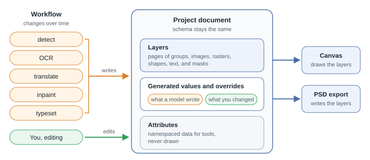
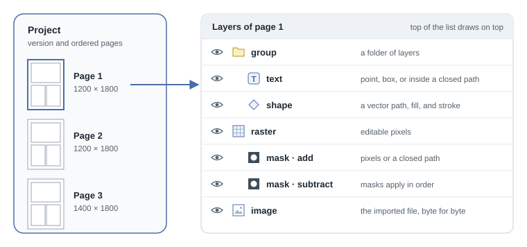
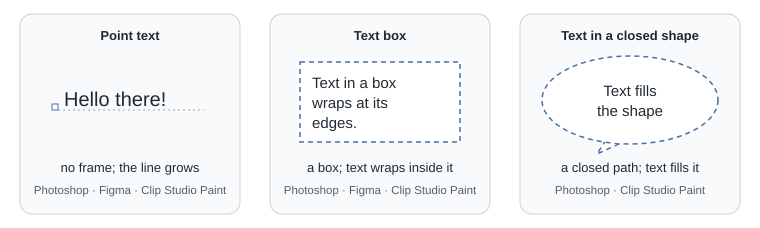
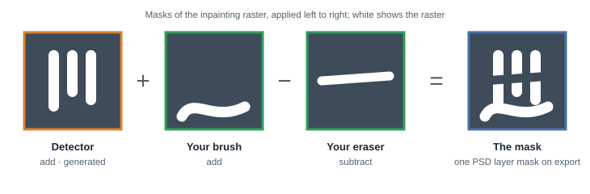
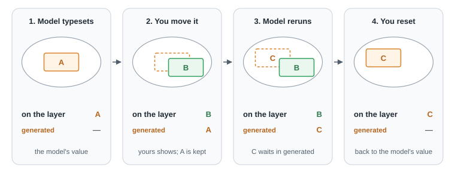
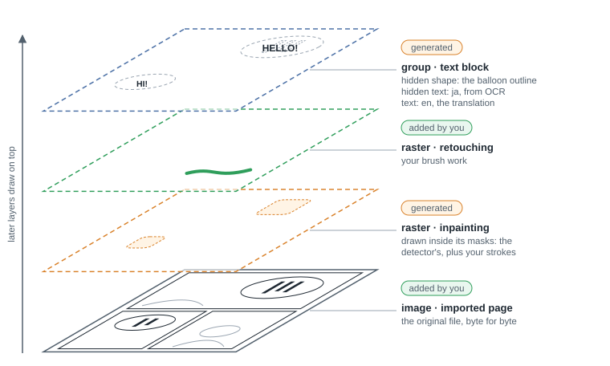
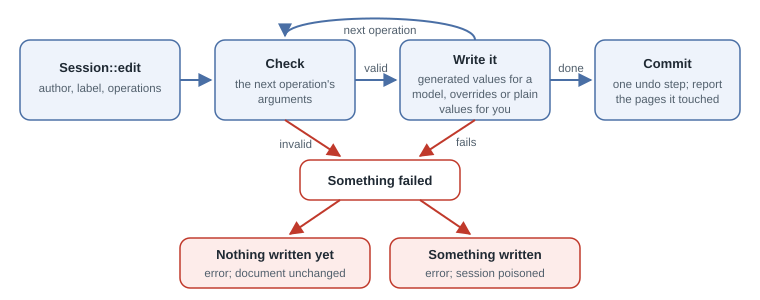

# koharu-scene on Loro: design for review

Nothing here is implemented yet.

Every element of this schema copies something an established editor or format
already has, and cites it. Nothing is new. Where sources differ, Photoshop and
Clip Studio Paint win, as for all editor behaviour in Koharu. The links are
listed under [Sources](#sources).

## Goal

A schema that lasts through workflow changes. The workflow (detect, OCR,
translate, inpaint, typeset) will change; the schema should not. So the schema
holds only what image editors have kept for decades, and everything
workflow-specific is data inside it.

The schema has three parts:

1. **Layers**: pages, each holding a tree of groups, images, rasters, shapes,
   text, and masks.
2. **Generated values and overrides**: what a model wrote stays apart from what
   the user changed.
3. **Attributes**: namespaced data for tools, which the renderer never reads.

## 1. Layers

### Project and pages

| Element | Model | Evidence |
|---|---|---|
| project | ordered pages and a `version` | a Clip Studio Paint EX work is one management file over its pages [CSP pages]; an OpenRaster image must carry a `version` [OpenRaster] |
| page | a `size` and its layers | each Clip Studio Paint page has its own canvas size [CSP page size]; a PSD document has a width and height [PSD spec]; each Photoshop artboard has its own size [Photoshop artboards] |

### Every layer

| Property | Model | Evidence |
|---|---|---|
| identity | stable for the layer's life | PSD `lyid` [PSD spec]; Figma node `id` [Figma nodes]; Krita layer `uuid` [Krita file] |
| `name` | string | PSD layer name [PSD spec]; Figma `name` [Figma nodes]; OpenRaster `name` [OpenRaster] |
| `visible` | bool; hiding a group hides everything in it | PSD visible flag [PSD spec]; Figma `visible` [Figma nodes]; SVG `display: none` hides descendants [SVG rendering] |
| `locked` | bool | Figma `locked` [Figma node properties]; PSD lock settings [PSD spec] |
| `opacity` | 0 to 1 | Figma `opacity` [Figma node properties]; OpenRaster `opacity` [OpenRaster] |
| `blend` | normal, multiply, screen, and the other standard modes; pass-through for groups | PSD blend keys [PSD spec]; Figma `BlendMode`, including `PASS_THROUGH` [Figma property types]; OpenRaster `composite-op` [OpenRaster] |
| `transform` | 2D affine `[[a, b, c], [d, e, f]]` | Figma `relativeTransform` [Figma node properties]; the PSD type layer transform `xx, xy, yx, yy, tx, ty` [PSD spec] |
| `attributes` | see [section 3](#3-attributes) | |

Children are drawn first to last, so the last child is on top, as SVG paints in
document order [SVG rendering].

### Layer kinds

| Kind | Holds | Evidence |
|---|---|---|
| `group` | child layers | PSD layer groups (`lsct`) [PSD spec]; SVG `g` [SVG structure]; OpenRaster nested `stack` [OpenRaster]; Krita group layers [Krita layers] |
| `image` | an imported file, kept byte for byte, and its media type | Photoshop exports an embedded smart object "in its original format" [Photoshop smart objects]; SVG `image` [SVG image] |
| `raster` | editable pixels | PSD pixel layers [PSD spec]; GIMP layers [GIMP XCF]; Krita paint layers [Krita layers] |
| `shape` | a path of open or closed subpaths, a fill rule, an optional fill, and an optional stroke | PSD shape layers: vector path, fill (`SoCo`), stroke (`vstk`), and fill rule [PSD spec]; SVG `path` [SVG paths]; Figma `VECTOR` [Figma nodes] |
| `text` | styled text in a frame | [below](#text) |
| `mask` | a mask component | [below](#masks) |

### Text

| Property | Model | Evidence |
|---|---|---|
| `content` | a string whose runs carry character styles over the layer's `style` | Photoshop formats "selected characters or an entire type layer" [Photoshop characters]; Figma `characterStyleOverrides` and `styleOverrideTable` [Figma nodes]; Clip Studio Paint colours selected letters [CSP text editing] |
| `style` | Koharu's existing typography values | Figma `TypeStyle` [Figma property types]; Photoshop character formatting [Photoshop characters] |
| `frame` | none (point text), a box (paragraph text), or a closed path that the text fills | Photoshop point type, paragraph type [Photoshop type], and text inside a shape [Photoshop text in shapes]; Figma `textAutoResize` `WIDTH_AND_HEIGHT` and `NONE` [Figma text resize]; Clip Studio Paint point text and text boxes [CSP text] and balloon text [CSP balloons] |
| `direction` | horizontal or vertical | Clip Studio Paint Text Direction [CSP vertical text] |
| `language` | one BCP 47 tag | SVG `systemLanguage` [SVG structure]; C2PA `sourceLanguage` and `targetLanguage` [C2PA actions] |

SVG 2 dropped text inside shapes in 2026 because no renderer implemented it
[SVG text inside shapes dropped], so the closed-path frame follows Photoshop and
Clip Studio Paint.

### Masks

| Property | Model | Evidence |
|---|---|---|
| place | a child of the layer it limits; a layer can have several | Krita masks are child nodes of a layer [Krita layers]; a Lightroom mask is made of several components [Lightroom masking] |
| `mode` | add, subtract, or intersect, applied in order | Lightroom's Add, Subtract, and Intersect [Lightroom masking]; CSS `mask-composite` [CSS masking] |
| content | pixels or a closed path | the PSD layer mask and vector mask [PSD spec] |
| PSD export | the components merge into the layer's one mask | a PSD layer has one user mask and one vector mask [PSD spec]; a GIMP layer has one mask [GIMP XCF] |

Masks take `name` and `visible` from the common properties.

### Stored values

| Value | Model | Evidence |
|---|---|---|
| raster pixels | 64×64 tiles keyed by tile position, each compressed with zlib on its own; only tiles holding pixels are stored | GIMP stores 64-pixel tiles, each compressed on its own, zlib being one option [GIMP XCF]; Krita stores 64×64 tiles, each recorded with its x and y [Krita tiles] |
| path | SVG path data | SVG [SVG paths] |
| colour | Koharu's existing RGBA colour | Figma `Color` is r, g, b, a [Figma property types] |

## 2. Generated values and overrides

- **Origin.** A layer a model made records how, as a C2PA action: `action`
  (such as `c2pa.created` or `c2pa.translated`), `softwareAgent`, and
  `digitalSourceType` [C2PA actions]. A layer the user made has no origin.
  - Photoshop likewise keeps each Generative Fill result as its own Generative
    Layer [Photoshop Generative Fill].
  - Lightroom keeps its AI components, such as Subject or Sky, apart from Brush
    components [Lightroom masking].
- **Two sets of values.** A generated layer keeps the values its models wrote
  (`generated`) apart from the user's `overrides`. Each override is keyed by a
  property path such as `frame` or `style.size`.
  - Blender library overrides store override properties by RNA path over the
    linked data [Blender override API] [Blender overrides].
  - Figma instances store their overridden fields over the main component
    [Figma instances].
  - A layer the user made holds one set of values, like local data in Blender.
- **Reading.** An override wins; otherwise the generated value shows.
- **Rerunning a model** replaces the generated values that model writes and
  nothing else, so overridden properties keep the user's value.
  - In Blender, when the library changes, "unmodified properties" of the
    override are updated [Blender overrides].
  - Lightroom recomputes AI masks with Update [Lightroom masking].
- **Removed outputs.** When a rerun no longer produces a layer, the layer goes
  unless the user overrode something on it. Blender's resync likewise leaves
  user overrides unchanged unless the hierarchy is enforced [Blender overrides
  design].
- **Reset** deletes an override, so the generated value shows again: Figma's
  "Reset [property]" and "Reset all changes" [Figma reset overrides], and
  Blender's Reset and Remove Override [Blender overrides].
- **No conflict tracking.** Blender "only stores override operations, not
  override operands" [Blender overrides design], and neither Blender nor Figma
  reports when the value under an override changes. This design records
  nothing about the value an override replaced.

## 3. Attributes

- **Shape.** Each layer has `attributes`: namespace, then key, then value, like
  Figma's `setSharedPluginData(namespace, key, value)` [Figma plugin data] and
  GIMP parasites, whose names start with their plug-in's name [GIMP
  parasites].
- **Values** are strings, numbers, arrays, or nested maps, as in Blender custom
  properties [Blender custom properties].
- **Overrides.** Attributes take overrides like any other property; Blender
  custom properties can be "Library Overridable" [Blender custom properties].
- **Rendering.** The renderer never reads attributes, so two documents that
  differ only in attributes look the same. They are data for tools, like
  Figma plugin data [Figma plugin data] and SVG `data-*` attributes [SVG
  structure].
- **Unknown namespaces** are kept as they are, as GIMP saves persistent
  parasites [GIMP parasites]. Only core properties fail closed.

## Today's workflow, as data

This section is an example, not schema.

| Today | In the document |
|---|---|
| imported page | an `image` the user added |
| detected text block | a `group`, origin `c2pa.created` by the detector |
| balloon outline | a hidden `shape` in that group, with `koharu.role = "balloon"` |
| OCR result | a hidden `text` in that group, `language = "ja"`, its frame the detected box |
| translation | a visible `text` in that group, `language = "en"`, its frame the balloon outline, origin `c2pa.translated` |
| typesetting | the translation's generated `frame` and `style`; the user's adjustments are overrides |
| text mask | a `mask` on the inpainting raster from the detector, plus the user's own add and subtract masks |
| inpainting | a `raster` drawn inside its masks, origin `c2pa.created` by the inpainter |
| retouching | `raster` layers above it, added by the user |

The translation is the only visible text. The OCR text stays beside it in the
same group as its source.

Changing the workflow changes only this table. A new detector adds attributes;
a layout model writes generated `frame` values. The schema stays the same.

## Loro specifics

This section is implementation, not schema.

- **Identity** is `TreeID`.
  - Relations are nesting or attribute values, so layers never refer to each
    other by id.
  - Undo of a delete may therefore re-create a subtree under new `TreeID`s
    without breaking anything. Holders outside the document re-read their
    targets, and a pipeline result for a layer that no longer exists is
    rejected as stale.
- **Text** is `LoroText`. Style runs are Loro rich-text marks, whose keys and
  expand rules are registered on every load.
- **Rasters.** Each raster's tiles are their own container, so Loro decodes
  them only when they are read.
- **Undo** is Loro's `UndoManager`: one edit is one commit, which is one undo
  step.
- **Edits.** `Session::edit(author, label, closure)` writes generated values
  for a model author, and overrides or a user layer's values for the user.
  - Every operation checks its arguments before its first write, because Loro
    has no rollback.
  - A failure after a write poisons the session.
- **Change** names the pages an edit touched. It is built from Loro events by
  walking each event's layer up to its page.
- **Versioning.** The project `version` changes only when the core does: a new
  layer kind or core property. Unknown core data fails to open; unknown
  attributes never do.

## To prove in a spike before building

1. Undo of a deleted subtree restores its generated values, overrides, text
   marks, and raster tiles.
2. Reading a page view decodes no raster tile container.
3. Event paths inside a layer's maps, text, or tiles resolve to the layer and
   from there to its page.
4. Rich-text marks survive save and reopen.

## Open questions

1. **Later kinds.** Each could be added without breaking anything:
   - adjustment layers, like Photoshop adjustment layers or Krita filter layers
     and filter masks [Krita layers];
   - linked instances, like Figma components [Figma instances] or Photoshop
     linked smart objects [Photoshop smart objects].
2. **Pages.** Keep every page in one tree, as Figma keeps pages under one
   document [Figma nodes]? Or give each page its own container, as Clip Studio
   Paint keeps one file per page [CSP pages], so a page can move between
   projects whole?
3. **More than one target language.** Four established models:
   - Photoshop layer comps record which layers are visible [Photoshop layer
     comps];
   - InDesign condition sets switch text that varies "across platforms,
     languages" [InDesign condition sets];
   - SVG `switch` draws the first child matching `systemLanguage` [SVG
     structure];
   - Figma variable modes hold one string per language [Figma variables].
4. **Balloon text.** Keep Photoshop's model, where text fills a closed path of
   its own? Or adopt Clip Studio Paint's balloon layer, where the text and
   balloon share one layer and resizing the balloon re-places the text [CSP
   balloons]?

## Sources

Read in October 2026.

- Adobe: [PSD spec], [Photoshop type], [Photoshop characters], [Photoshop text
  in shapes], [Photoshop smart objects], [Photoshop artboards], [Photoshop
  Generative Fill], [Photoshop layer comps], [Lightroom masking], [InDesign
  condition sets]
- Clip Studio Paint: [CSP pages], [CSP page size], [CSP text], [CSP text
  editing], [CSP vertical text], [CSP balloons]
- Figma: [Figma nodes], [Figma node properties], [Figma property types],
  [Figma text resize], [Figma plugin data], [Figma instances], [Figma reset
  overrides], [Figma variables]
- W3C: [SVG structure], [SVG rendering], [SVG paths], [SVG image], [SVG text
  inside shapes dropped], [CSS masking]
- Others: [OpenRaster], [Krita layers], [Krita file], [Krita tiles], [GIMP
  XCF], [GIMP parasites], [Blender overrides], [Blender overrides design],
  [Blender override API], [Blender custom properties], [C2PA actions]

[PSD spec]: https://www.adobe.com/devnet-apps/photoshop/fileformatashtml/
[Photoshop type]: https://helpx.adobe.com/photoshop/desktop/text-typography/type-layers-creation/type-layers-in-photoshop.html
[Photoshop characters]: https://helpx.adobe.com/photoshop/desktop/text-typography/characters-glyphs/format-characters.html
[Photoshop text in shapes]: https://helpx.adobe.com/photoshop/desktop/text-typography/text-on-paths-shapes/add-text-along-paths-or-inside-shapes.html
[Photoshop smart objects]: https://helpx.adobe.com/photoshop/desktop/create-manage-layers/smart-objects/export-the-contents-of-an-embedded-smart-object.html
[Photoshop artboards]: https://helpx.adobe.com/photoshop/desktop/create-manage-layers/layout-design-tools/get-started-artboards.html
[Photoshop Generative Fill]: https://helpx.adobe.com/photoshop/desktop/create-open-import-images/create-images/edit-images-with-generative-fill.html
[Photoshop layer comps]: https://helpx.adobe.com/photoshop/desktop/create-manage-layers/create-layer-compositions/create-and-manage-layer-comps.html
[Lightroom masking]: https://helpx.adobe.com/lightroom-classic/desktop/process-and-develop-photos/masking.html
[InDesign condition sets]: https://helpx.adobe.com/indesign/desktop/add-and-manage-text/conditional-and-variable-text/use-condition-sets.html
[CSP pages]: https://help.clip-studio.com/en-us/manual_en/570_pages/Management_Files_and_Page_Files.htm
[CSP page size]: https://help.clip-studio.com/en-us/manual_en/210_file/Change_canvas_size_and_settings.htm
[CSP text]: https://help.clip-studio.com/en-us/manual_en/480_text/Adding_text.htm
[CSP text editing]: https://help.clip-studio.com/en-us/manual_en/480_text/Editing_text.htm
[CSP vertical text]: https://help.clip-studio.com/en-us/manual_en/480_text/Vertical_text_and_readings.htm
[CSP balloons]: https://help.clip-studio.com/en-us/manual_en/540_comic/Balloons.htm
[Figma nodes]: https://developers.figma.com/docs/rest-api/file-node-types/
[Figma node properties]: https://developers.figma.com/docs/plugins/api/node-properties/
[Figma property types]: https://developers.figma.com/docs/rest-api/file-property-types/
[Figma text resize]: https://developers.figma.com/docs/plugins/api/properties/TextNode-textautoresize/
[Figma plugin data]: https://developers.figma.com/docs/plugins/api/properties/nodes-setsharedplugindata/
[Figma instances]: https://developers.figma.com/docs/plugins/api/InstanceNode/
[Figma reset overrides]: https://help.figma.com/hc/en-us/articles/360039150733
[Figma variables]: https://help.figma.com/hc/en-us/articles/14506821864087
[SVG structure]: https://www.w3.org/TR/SVG2/struct.html
[SVG rendering]: https://www.w3.org/TR/SVG2/render.html
[SVG paths]: https://www.w3.org/TR/SVG2/paths.html
[SVG image]: https://www.w3.org/TR/SVG2/embedded.html#ImageElement
[SVG text inside shapes dropped]: https://github.com/w3c/svgwg/issues/1067
[CSS masking]: https://www.w3.org/TR/css-masking-1/#the-mask-composite
[OpenRaster]: https://www.openraster.org/baseline/layer-stack-spec.html
[Krita layers]: https://docs.krita.org/en/reference_manual/layers_and_masks.html
[Krita file]: https://invent.kde.org/graphics/krita/-/blob/master/plugins/impex/libkra/kis_kra_savexml_visitor.cpp
[Krita tiles]: https://invent.kde.org/graphics/krita/-/blob/master/libs/image/tiles3/swap/kis_tile_compressor_2.cpp
[GIMP XCF]: https://developer.gimp.org/core/standards/xcf/
[GIMP parasites]: https://developer.gimp.org/core/specifications/parasites/
[Blender overrides]: https://docs.blender.org/manual/en/latest/files/linked_libraries/library_overrides.html
[Blender overrides design]: https://developer.blender.org/docs/features/core/overrides/library/
[Blender override API]: https://docs.blender.org/api/current/bpy.types.IDOverrideLibraryProperty.html
[Blender custom properties]: https://docs.blender.org/manual/en/latest/files/custom_properties.html
[C2PA actions]: https://spec.c2pa.org/specifications/specifications/2.2/specs/C2PA_Specification.html#_actions
