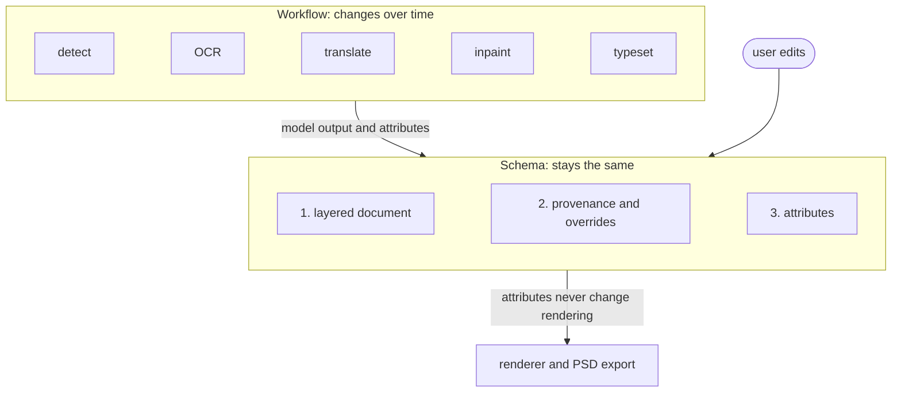
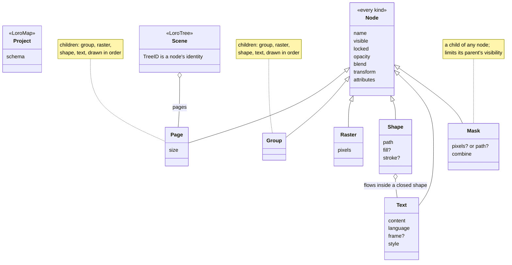
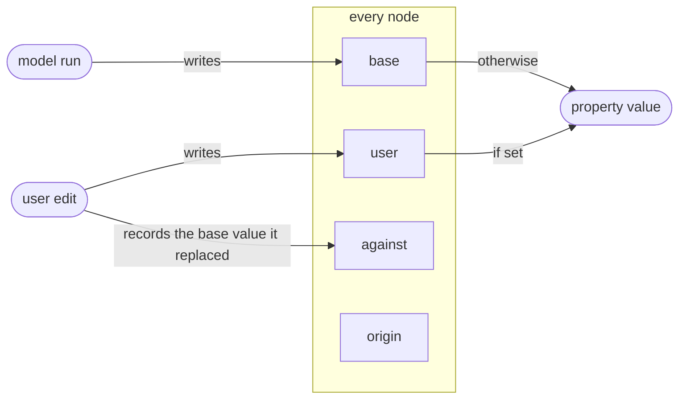
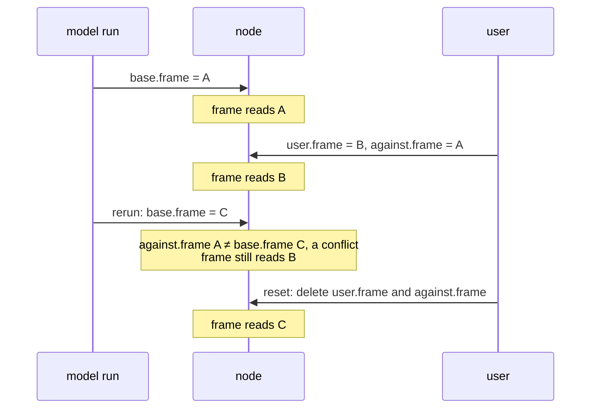
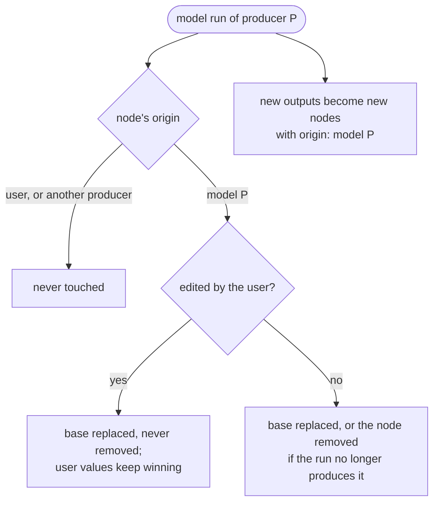
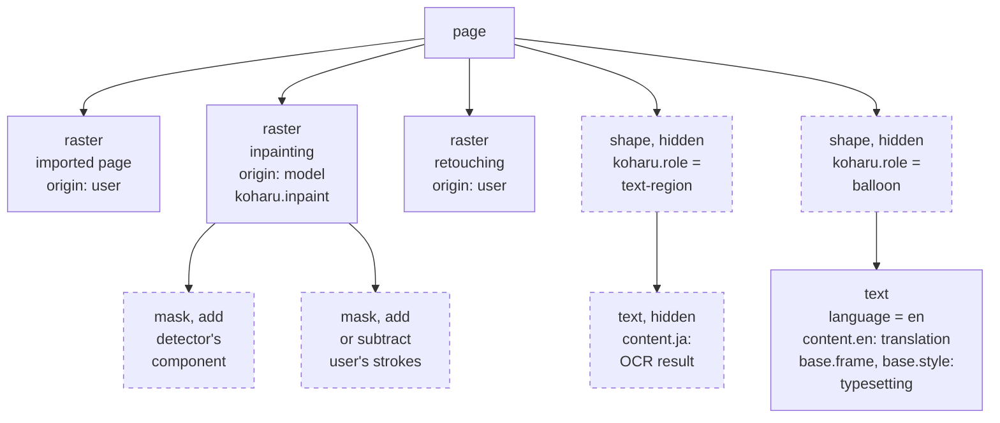
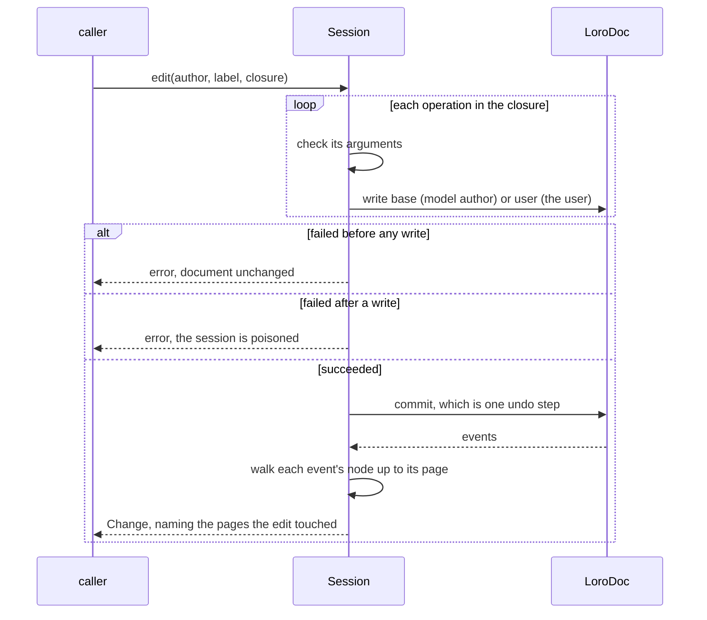

# koharu-scene on Loro: design for review

Nothing here is implemented yet.

## Goal

A schema that lasts through workflow changes. The workflow (detect, OCR,
translate, inpaint, typeset) will change; the schema should not. So the schema
models only what has stayed stable in image editors for decades, and everything
workflow-specific is data inside it.

The schema has three parts:

1. **A layered document**: pages of node trees made of groups, rasters,
   shapes, text, and masks. This is the model PSD, SVG, OpenRaster, Krita, and
   Figma all share, and the one Koharu already exports to PSD.
2. **Provenance and overrides**: one mechanism, for every property of every
   node, that keeps model output and user edits apart.
3. **Attributes**: an open, namespaced map on every node for meaning the core
   does not define, such as "this shape is a balloon" or "OCR confidence".

A new workflow adds producers and attributes. It does not change the schema.



## 1. Layered document



| Kind | Properties | Drawn as | PSD |
|---|---|---|---|
| all | `name`, `visible`, `locked`, `opacity`, `blend`, `transform` (2D affine), `attributes` | | layer basics |
| `page` | `size` | its children | document |
| `group` | none | its children | group |
| `raster` | `pixels: Raster` | its pixels | pixel layer |
| `shape` | `path` (closed or open), `fill?`, `stroke?` | its path | shape layer |
| `text` | `content`, `language`, `frame?`, `style` | the `content[language]` text | type layer |
| `mask` | `pixels?: Raster` or `path?`, `combine: add, subtract, or intersect` | not drawn; limits its parent | layer or vector mask |

### Rules every renderer and exporter follows

- **Hidden helpers.** A node with `visible: false` is not drawn. Detection
  geometry, guides, and other helper shapes are such shapes.
- **Masks.** A parent's visibility is the combination of its `mask` children,
  in order. This gives Lightroom-style masks: a model's raster component plus
  the user's add and subtract strokes.
- **Text in shapes.** A `text` whose parent is a closed `shape` flows inside
  that shape (area type, like SVG 2 `shape-inside` or text inside a path in
  Photoshop). Several texts in one shape share its area in order. Elsewhere, a
  `text` lays out in its own `frame`, or as point text without one.
- **Multilingual text.** `content` holds text per language, each a
  `LoroText`. The renderer draws `content[language]`. Per-span styling is Loro
  rich-text marks over the node's `style`.
- **Attributes never change rendering.** Two documents that differ only in
  attributes render identically.

### Values

- **`Raster`** is a convention, since Loro has no image type:
  `{ width, height, tiles }`, where `tiles` maps `"x,y"` to a 256×256 PNG
  stored as Loro binary. Missing tiles are transparent. An imported original
  can instead stay as `{ media_type, bytes }`.
- **Containers.** Every raster is its own container, so Loro decodes it only
  when it is read.
- **Other values.** `path` is a list of commands. Colours are RGBA `[u8; 4]`.

## 2. Provenance and overrides

Every node carries:

```text
origin   user | model { producer, model?, run }
base     LoroMap   properties written by model runs
user     LoroMap   properties written by the user
against  LoroMap   for each user value over a base value, the base it replaced
```



- **Reading.** A property's value is `user[path]` if the user set it,
  otherwise `base[path]`. The path reaches inside maps, so it covers
  `content.en` and individual attributes too.
- **Writing.**
  - A model run writes only `base`.
  - The user writes only `user`, and records `against` when a base value
    exists.
  - The two never write the same place, so neither can overwrite the other
    and no ownership check is needed.
- **Resetting.** Deleting `user[path]` and `against[path]` returns a property
  to the model's value.
- **Conflicts.** A property is in conflict when `against[path] != base[path]`,
  meaning the model changed under the user's edit. The user's value still wins
  until reset.
- **Regenerating.** A model run replaces the `base` of the nodes it produced,
  and creates or removes nodes whose `origin` is that producer, but never a
  node the user created or edited.

One property through its life:



What a model run does to each node:



This is Blender's library overrides and Figma's instance overrides, applied to
one document instead of linked files.

## 3. Attributes

- **Keys.** `attributes` is a map whose keys are namespaced, such as
  `koharu.role`, `koharu.ocr.confidence`, or a future
  `koharu.reading-order`.
- **Values.** Values are plain Loro values or `LoroText`.
- **Who reads them.** The core stores attributes, overrides them like any
  other property, and never interprets them.
- **What fails.** Unknown attribute keys are kept as they are; only core
  properties fail closed. This is Blender's custom properties, SVG's `data-*`
  attributes, and Figma's plugin data.

## Today's workflow, expressed as data

This section is an example, not schema:

| Today | In the document |
|---|---|
| imported page image | `raster`, `origin: user` |
| detected balloon | `shape` with `koharu.role = "balloon"`, `visible: false` |
| detected text region | hidden `shape` with `koharu.role = "text-region"`, holding a hidden `text` whose `content.ja` is the OCR result |
| translation | a `text` inside its balloon `shape`, `content.en` from the translation run, `language = "en"` |
| text mask | a `mask` under the cleanup `raster`: the detector's component plus the user's stroke components |
| inpainting | a `raster`, `origin: model { producer: "koharu.inpaint" }`, drawn inside its mask |
| retouching | `raster` layers above, `origin: user` |
| layout from typesetting | the text's `base.frame` and `base.style`; the user's adjustments go in `user` |

One page as a tree. Children are drawn left to right; dashed nodes are not
drawn.



Changing the workflow changes only this table. Examples:

- A new detector emits extra attributes.
- A translation run writes a second language.
- A layout model writes `base.frame`.

The document and its schema stay the same.

## Loro specifics

- **Identity** is `TreeID`.
  - Relations are nesting (masks, text in shapes) or attributes holding plain
    values, so nodes never refer to each other by id.
  - Undo of a delete may therefore re-create a subtree under new `TreeID`s
    without breaking anything. Holders outside the document re-read their
    targets, and a pipeline result for a node that no longer exists is
    rejected as stale.
- **Text** is `LoroText`, with mark keys and their expand rules registered on
  every load.
- **Undo** is Loro's `UndoManager`: one edit is one commit, which is one undo
  step.
- **Edits.** `Session::edit(author, label, closure)` writes `base` for a model
  author and `user` for the user.
  - Every operation checks its arguments before its first write, because Loro
    has no rollback.
  - A failure after a write poisons the session.
- **Change** names the pages an edit touched. It is built from Loro events by
  walking each event's node up to its page.


- **Versioning.** `project.schema` changes only when the core does: a new node
  kind or core property. Unknown core data fails to open; unknown attributes
  never do.

## To prove in a spike before building

1. Undo of a deleted subtree restores its `base`, `user`, `against`,
   `LoroText` marks, and raster containers.
2. Reading a page view decodes no raster container.
3. Event paths inside a node's maps, `LoroText`, or tiles resolve to the node
   and from there to its page.
4. Rich-text marks survive save and reopen.

## Open questions

1. **Core kinds:** are `group`, `raster`, `shape`, `text`, and `mask` enough
   for years? Candidates to add later without breaking anything:
   - adjustment or filter nodes, like Photoshop adjustment layers or Krita
     filter masks;
   - instances, a reference to another subtree, like smart objects or
     components.
2. **Conflicts:** report them, as Blender does, or only offer reset, as Figma
   does?
3. **Pages:** keep pages as nodes in one tree, or give each page its own
   `LoroTree`, so a page can move between projects whole?
